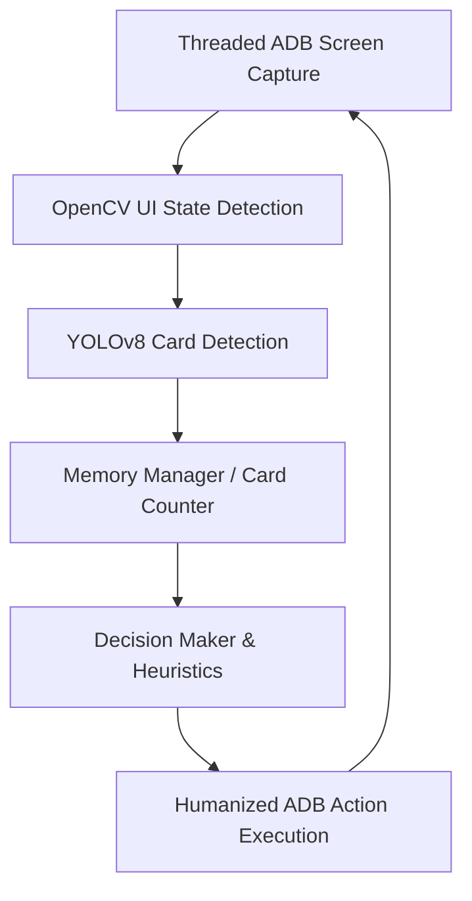

# 🃏 Autonomous Chkobba AI Agent


An intelligent, state-aware autonomous agent designed to play the traditional Tunisian card game **Chkobba** on Android devices. 

Moving beyond simple automated scripts, this project implements a complete **Agentic AI architecture**. It "sees" the game via real-time computer vision, remembers every card played using absolute card counting, evaluates mathematical probabilities dynamically, and executes humanized actions on the device.

## ✨ Key Features

### 👁️ 1. Real-Time Computer Vision & Perception
* **YOLOv8 Object Detection:** Custom-trained model to instantly identify cards in the player's hand, on the table, and within fast-moving opponent action popups.
* **Zero-Latency Threaded Capture:** Utilizes a multi-threaded ADB (Android Debug Bridge) pipeline to read the device's screen directly from memory buffer (up to 60 FPS) without blocking the AI's decision loop.
* **Active Blind-Spot Monitoring:** Continuously scans the screen even during opponent turns and round transitions to ensure no rapid UI popups or opponent moves are missed.

### 🧠 2. Absolute Memory & State Tracking
* **Perfect Card Counting:** Tracks all 40 cards in the deck. The bot knows exactly which cards have been played, which are in its own score pile, and which belong to the opponent.
* **Real-Time Score Calculator:** Continuously evaluates the current round's score (Tracking the *Sab3a 7aya* / 7 of Diamonds, total Dinars, 6s, and 7s).
* **Auto-Synchronization:** Detects the end of a round (40 cards played) and automatically resets its memory for the new round.

### 🤖 3. Agentic AI & Dynamic Reward Shaping
* **Rules Engine:** Mathematically calculates all valid combinations (e.g., an 8 can eat an 8, or a 5+3, or a 4+3+1).
* **Context-Aware Valuations:** The AI doesn't use static values. If it has already secured three "7s" (Bermila), it drops the priority of the last 7 to focus on Dinars.
* **Defensive Anti-Chkobba Logic:** Before discarding a card (*7ot*), the bot cross-references its memory. If it needs to throw a 4, and knows the other three 4s are already discarded or in its hand, it calculates a **0% Chkobba risk** and plays safely.

### 🦾 4. Humanized RPA (Robotic Process Automation)
* **Gaussian Noise Clicks:** Actions are executed via ADB with randomized coordinate offsets (radius) and micro-delays to simulate real human touches and avoid anti-bot detection systems.

---

## 🏗️ Architecture



---

## ⚙️ Prerequisites

* Python 3.9+
* Android device or Emulator (e.g., LDPlayer, BlueStacks, Scrcpy) with **USB Debugging enabled**.
* ADB installed and added to your system PATH.

## 🚀 Installation

1. **Clone the repository:**
   ```bash
   git clone https://github.com/AlaMadani/Chkobba_Agent.git
   cd Chkobba_Agent
   ```

2. **Create a virtual environment & install dependencies:**
   ```bash
   python -m venv venv
   source venv/bin/activate  # On Windows use: venv\Scripts\activate
   pip install -r requirements.txt
   ```

3. **Add the YOLO Model:**
   Place your trained YOLOv8 model (`best.pt`) inside the `assets/` directory.

---

## 🎮 Usage

1. Connect your Android device or start your emulator.
2. Verify the connection with ADB:
   ```bash
   adb devices
   ```
   *Note the IP/Port or Serial ID of your device.*
3. Update `src/main.py` or `src/bot/adb_controller.py` with your specific Device ID if necessary.
4. Launch the game on your device and navigate to a match.
5. Start the AI Agent:
   ```bash
   python -m src.main
   ```

## 🛠️ Configuration (`src/config.py`)

You can adjust the bot's behavior in the `GameConfig` class:
* `YOLO_CONFIDENCE`: Adjust the detection threshold.
* `SCREEN_WIDTH` / `SCREEN_HEIGHT`: Set to your device's native resolution for accurate coordinate mapping.
* `TURN_DOT_ROI`: Adjust the coordinates to detect the green "my turn" indicator.

---

## ⚠️ Disclaimer
This project was built strictly for **educational purposes** to explore Computer Vision, State-Aware AI, and RPA pipelines on mobile interfaces. Please respect the terms of service of the games you play.

## 🤝 Contributing
Contributions, issues, and feature requests are welcome! Feel free to check the [issues page](https://github.com/yourusername/chkobba-ai-bot/issues).
